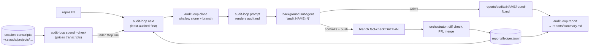

# claude-cloud-audit-loop

Spend a fixed dollar budget on **independent fact-check audits of many GitHub repositories, from inside one [Claude Code](https://code.claude.com/docs/en/overview) session**: cloud ([Claude Code on the web](https://code.claude.com/docs/en/claude-code-on-the-web)) or local. No API key and no SDK are needed. The session you are already in orchestrates; background [subagents](https://code.claude.com/docs/en/sub-agents) audit one repository each; a small CLI keeps state and measures spend.

**Why:** a block of credits, such as a free cloud allowance, can audit dozens of repositories without anyone running each audit by hand.

**How it works**
- **Audit.** Every audit gets the same instruction: fact-check all claims in README, docs, AGENTS.md, results, code, experiment reports, paper, Hugging Face card and UI; fix them; add sources; don't train models. The audit [prompt](src/audit_loop/prompts/audit.md) adds:
  - the order of evidence: result files and code, then primary sources fetched live, then "unverifiable"
  - a rule never to change data to match prose
  - compute limits and a per-audit soft budget
  - a structured report
- **Land.** Fixes go to a branch per audit. The orchestrator checks the diff, opens a PR and merges it.
- **Spend.** It is measured from the session's own transcripts at list prices, including subagents. The loop stops at `budget − margin`.
- **Rounds.** Repositories are audited round-robin. When all have finished round 1, round 2 starts, independently of round 1.

For the same loop **outside a session**, with an API key and the Agent SDK, see [claude-agent-sdk-audit-loop](https://github.com/BurnyCoder/claude-agent-sdk-audit-loop).

## Data flow



## Install

You need [uv](https://docs.astral.sh/uv/), git and Claude Code. The package uses only the Python standard library; pytest is a dev dependency.

```bash
git clone https://github.com/BurnyCoder/claude-cloud-audit-loop- && cd claude-cloud-audit-loop-
```

```bash
uv sync && uv run pytest -q
```

## Use

1. Copy `.env.example` to `.env`. Set the budget, and optionally commit trailers.
2. Put the repositories you can push to in `repos.txt`, one per line (see `repos.example.txt`).
3. Open a Claude Code session in this folder and say: **"Run the audit loop per AGENTS.md."** [AGENTS.md](AGENTS.md) is the orchestrator procedure the session follows.
4. In a cloud session, the session asks for push access to each repository (`add_repo`). On your own machine, your git credentials are used.

| Command | What it does |
|---|---|
| `audit-loop spend [--check] [--agent DESC] [--total] [--json]` | List-price spend of this session: main thread plus each subagent. `--check` exits 3 at the stop line or after `AUDIT_STOP_AT` |
| `audit-loop next [-n N]` | Next `owner/name round` pairs: least-audited first, then list order, skipping audits in flight |
| `audit-loop clone REPO --round R` | Shallow-clone or refresh into `workdir/`; check out `fact-check/<date>-rR` from the default branch |
| `audit-loop prompt REPO --round R [--cap USD]` | Print the audit prompt with paths, branch, budget commands and commit trailer filled in |
| `audit-loop record REPO --round R --status S [--pr URL]` | Append to `reports/ledger.jsonl`; the cost defaults to that audit's subagent spend |
| `audit-loop pr-body REPO --round R` | Print a PR description: the report's Summary, its counts and a link to the full report |
| `audit-loop report` | Regenerate `reports/summary.md` from the ledger and the report front-matter |

Settings are listed in [.env.example](.env.example). Precedence: flags, then `AUDIT_*` environment variables, then `.env`.

## How spend is measured

Claude Code writes every API response, with its `usage` block, to `~/.claude/projects/<project>/<session>.jsonl`. Subagents get `<session>/subagents/agent-<id>.jsonl`, with the Agent tool's description in `agent-<id>.meta.json`. `audit-loop spend` counts each message id once and applies [list prices](https://platform.claude.com/docs/en/about-claude/pricing), checked 2026-11-05 (USD per million tokens):

| Model | Input | 5 min cache write | 1 h cache write | Cache read | Output |
|---|---|---|---|---|---|
| Claude Opus 5.5 | 4 | 5 | 8 | 0.20 | 20 |
| Claude Sonnet 5.5 | 2 | 2.50 | 4 | 0.10 | 10 |
| Claude Haiku 5.5 (prompt ≤ 100k tokens) | 0.10 | 0.125 | 0.20 | 0.01 | 0.50 |
| Claude Haiku 5.5 (prompt > 100k tokens) | 0.50 | 0.625 | 1 | 0.05 | 2.50 |

Web search adds $10 per 1,000 searches. Models not in the table are priced as Opus 5.5, with a warning.

**Accuracy and caveats**
- On this repository's own session, the result matched an independent `jq` sum of the same transcripts to the cent.
- Against the cloud credit balance shown to the user, the meter read about 3–4% low ($96–97 when the balance showed $101 spent). One plausible cause is that tool-internal model calls, such as WebFetch's page summarization, are not written to the transcripts. Leave margin for this.
- These figures are list-price estimates, not billing statements: fast mode and batch discounts are not modelled. That is why there are two margins:
  - the loop stops launching audits `AUDIT_STOP_MARGIN_USD` below the budget, which should be at least the caps of the audits in flight;
  - running audits wrap up `AUDIT_HARD_MARGIN_USD` below it.
- For credits that expire, set `AUDIT_STOP_AT`; `spend --check` also exits 3 after that time.
- Each audit's soft cap is enforced by the subagent itself, which checks `spend --agent` about every 20 tool calls, so an audit can overshoot its cap by a few calls.

## Safety

- Audits run with your permissions. They push branches; the orchestrator merges PRs after a diff check. Use it only on repositories you are happy to have changed.
- The prompt forbids force-pushes, committing secrets, editing result data to match prose, training models, downloads over 1 GB and commands over 10 minutes.
- `.env`, `repos.txt` and `workdir/` are gitignored.

## Results of runs

[reports/summary.md](reports/summary.md) is generated by `audit-loop report`. It lists every audit with its cost, claim counts and PR link, and links each detailed report under [reports/audits/](reports/audits/).
